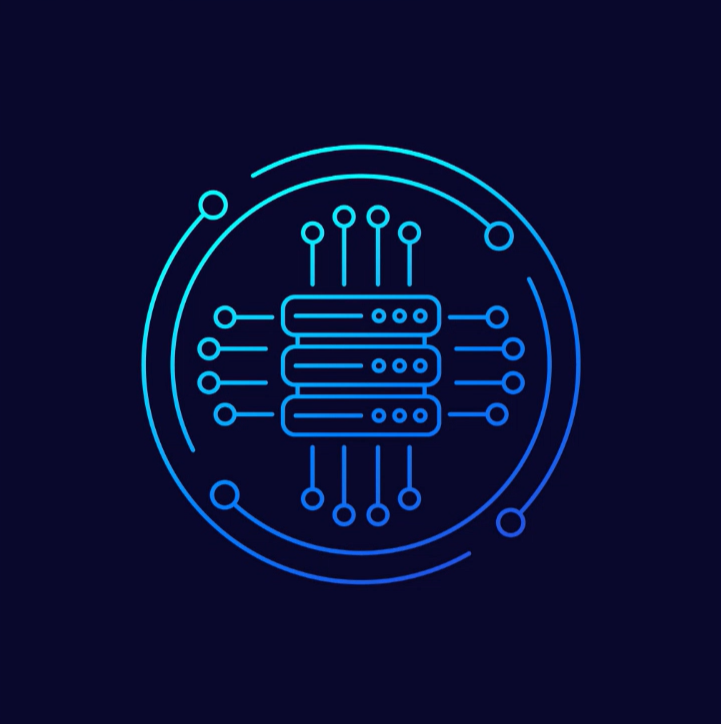
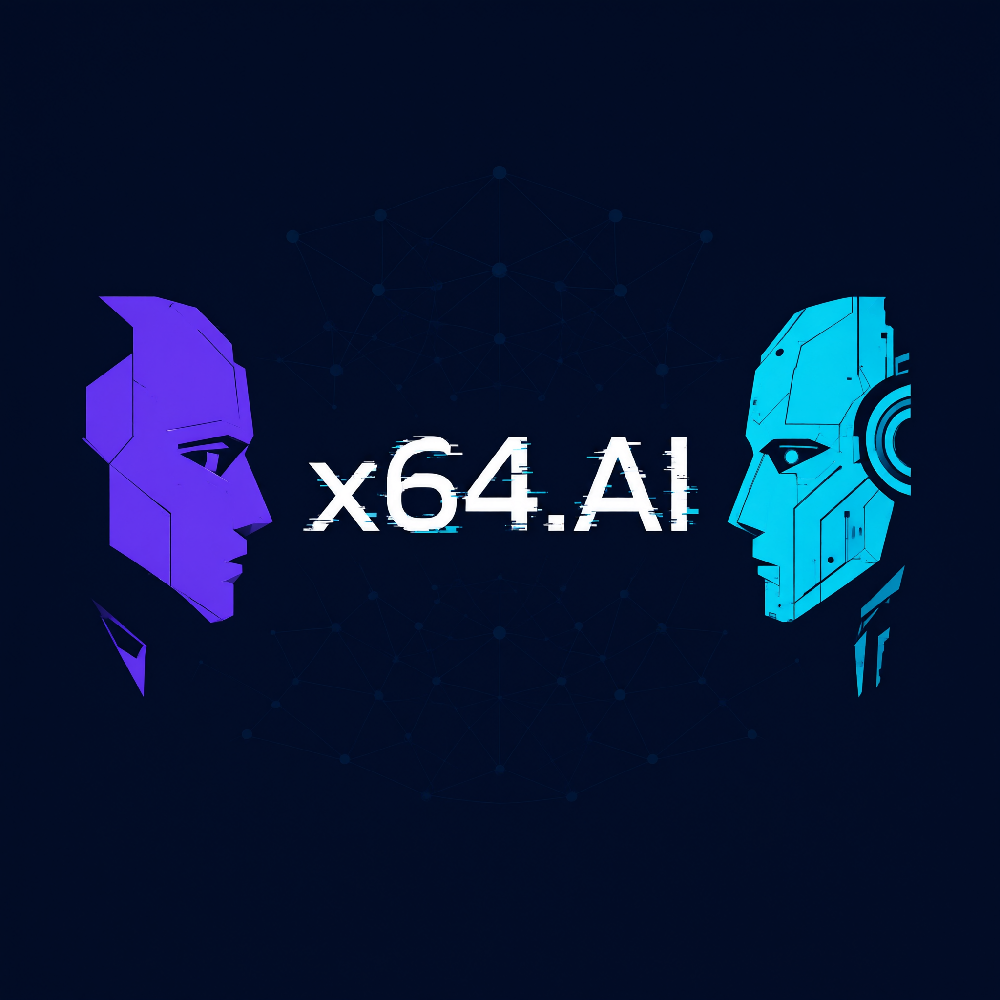
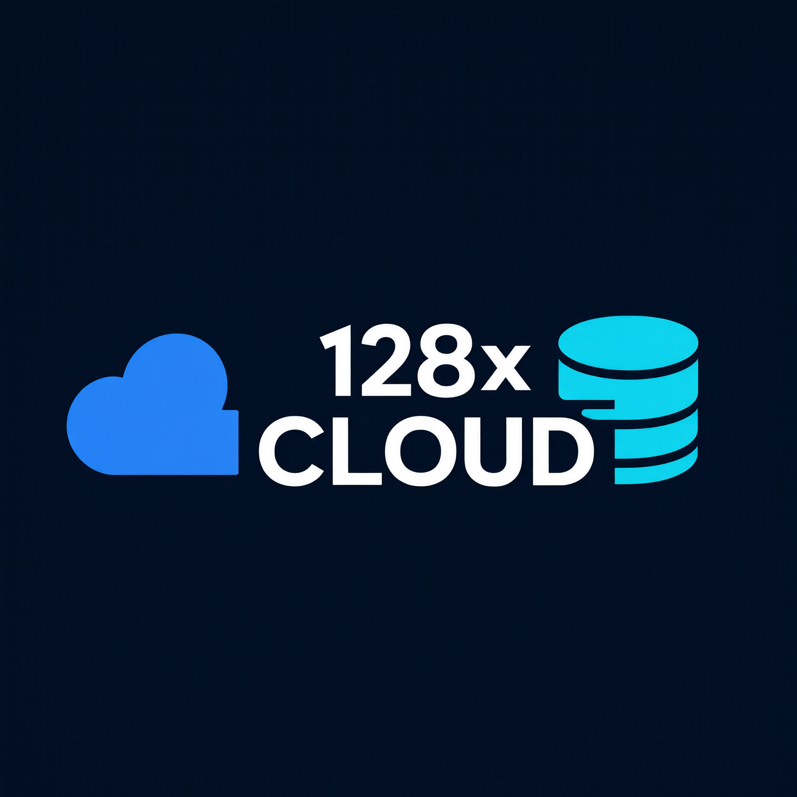
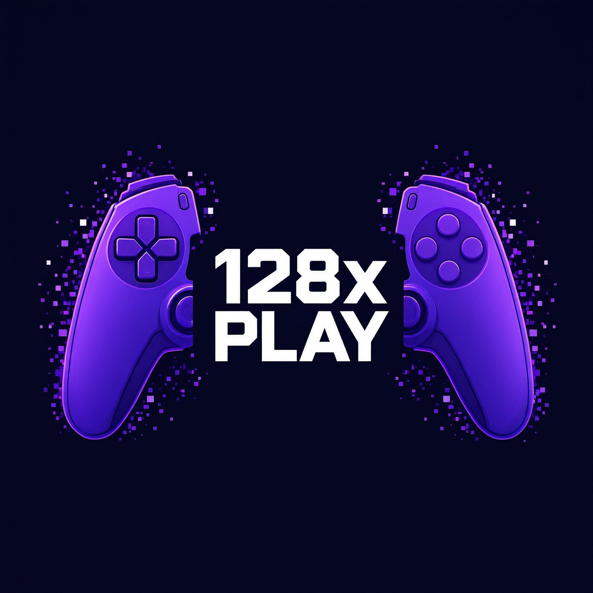

  

# 128x64

### BUILDING WHAT'S NEXT.

**Technology. Infrastructure. Intelligence. Entertainment.**

We build technology, develop digital products, and explore ideas that make computing more capable, accessible, and useful.

[Explore Projects](https://github.com/orgs/128x64/repositories) · [Our Organization](https://github.com/128x64) · [Get Involved](#get-involved)

---

**Technology built with purpose. Progress built over time.**

*Independent thinking. Practical technology. Long-term ambition.*

## Featured Project — Harbor CLI

  

**Harbor CLI** is the flagship project of 128x64.

Explore its source code, development, documentation, and project updates through the official repository.

  

---

## Welcome to 128x64

**128x64** is a technology company focused on the development of **software**, **digital platforms**, **infrastructure**, and **emerging technologies**.

Our work spans multiple areas of the technology industry, bringing together different disciplines under one organization. From artificial intelligence and intelligent software to gaming experiences and hosting infrastructure, we aim to create products and services that solve meaningful problems and deliver practical value.

We believe technology should do more than demonstrate what is possible. It should help people accomplish things, give developers better tools, make digital experiences more accessible, and provide dependable foundations for the services people rely on.

Our approach is built around experimentation, engineering, continuous improvement, and a long-term commitment to useful technology.

128x64 brings these ambitions together through specialized divisions, each with its own area of focus and development direction.

## 👥 Leaders

<table>
  <tr>
    <!-- PROFILE CARD 1 -->
    <td width="33%" valign="top">
      
      <h3 align="center"><a href="https://github.com/Raphael-Varghese">Raphael Varghese</a></h3>
      
<strong>Owner · Shareholder · Cofounder</strong>

      

      <ul>
        <li>CoLeader of x64.AI</li>
        <li>CoLeader of 128x CLOUD</li>
        <li>Leader of 128x PLAY</li>
        <li>Department of Cybersecurity</li>
        <li>Department of AI Fine-Tuning</li>
        <li>Coowner of Department of AI Inferencing</li>
        <li>Coowner of Department of AI Research</li>
        <li>Coowner of Department of AI Training</li>
      </ul>
    </td>
    <!-- PROFILE CARD 2 -->
    <td width="33%" valign="top">
      
      <h3 align="center"><a href="https://github.com/Ihaterbrrjdn">Sai Peddada</a></h3>
      
<strong>Shareholder · Cofounder</strong>

      

      <ul>
        <li>CoLeader of x64.AI</li>
        <li>Coowner of Department of AI Research</li>
        <li>Coowner of Department of AI Training</li>
      </ul>
    </td>
    <!-- PROFILE CARD 3 -->
    <td width="33%" valign="top">
      
      <h3 align="center">Atharvo Rai</h3>
      
<strong>Shareholder · Cofounder</strong>

      

      <ul>
        <li>CoLeader of x64.AI</li>
        <li>CoLeader of 128x CLOUD</li>
        <li>Coowner of Department of AI Inferencing</li>
      </ul>
    </td>
  </tr>
</table>

## Our Mission

Our mission is to build and deliver technology that makes digital experiences more capable, dependable, and accessible.

We aim to:

- Develop useful software and services that address real-world needs.
- Explore emerging technologies and turn promising ideas into practical products.
- Build dependable digital infrastructure for individuals, developers, and organizations.
- Create engaging gaming and entertainment experiences.
- Support developers and communities through tools, documentation, and collaboration.
- Approach engineering with care for security, privacy, accessibility, and reliability.
- Build an interconnected technology ecosystem that can grow and evolve over time.

## Our Divisions

128x64 operates through specialized divisions. Each division focuses on a distinct part of the technology landscape while contributing to the broader direction of the company.

---

### x64.AI

  

#### Artificial Intelligence · Research · Intelligent Software

x64.AI is the artificial intelligence division of 128x64. Its focus is the research, development, and practical application of intelligent software and AI-powered technologies.

Artificial intelligence is changing how people interact with information, create software, automate work, and solve complex problems. x64.AI aims to explore these possibilities while keeping practical usefulness, responsible development, and technical quality at the center of its work.

**Areas of focus**

- **AI models and experimentation** — Exploring model architectures, evaluating existing models, and experimenting with approaches to improve useful capabilities.
- **AI-powered applications** — Developing applications that use artificial intelligence to assist with everyday tasks, research, creativity, and productivity.
- **Agents and automation** — Exploring systems that can coordinate tools and complete structured tasks with appropriate permissions, oversight, and safeguards.
- **Developer infrastructure** — Building tools and interfaces that make AI systems easier to integrate, operate, evaluate, and maintain.
- **Research and evaluation** — Testing system behavior, measuring performance, identifying limitations, and documenting results.
- **Local and accessible AI** — Exploring ways to make intelligent software more flexible and accessible across different hardware and environments.
- **Responsible AI engineering** — Considering privacy, security, transparency, reliability, and human oversight throughout development.

**Our direction**

We want x64.AI to contribute practical AI products and engineering tools—not just experiments. Our focus is on building systems that people can understand, evaluate, and use responsibly.

Learn more through the organization's public repositories as projects become available.

---

### 128x CLOUD

  

#### Web Hosting · Cloud Infrastructure · Developer Services

128x CLOUD is the infrastructure and hosting division of 128x64.

Websites, applications, APIs, online communities, and digital services all depend on infrastructure that works reliably. This division is focused on exploring and developing hosting and infrastructure services that help people put their projects online and keep them operating.

**Areas of focus**

- **Web hosting** — Hosting foundations for websites, web applications, and online projects.
- **Application hosting** — Exploring environments for deploying and operating applications and services.
- **Cloud infrastructure** — Building knowledge and capabilities around scalable computing, storage, networking, and deployment.
- **Developer services** — Creating straightforward workflows and tools that help developers publish and maintain their projects.
- **Domains and web services** — Exploring services that help individuals and organizations establish and manage their online presence.
- **Reliability and monitoring** — Emphasizing service health, operational visibility, backups, and dependable maintenance.
- **Security and data protection** — Treating access control, secure configuration, updates, and responsible data handling as core infrastructure requirements.

**Our direction**

128x CLOUD aims to make dependable infrastructure easier to understand and use. The long-term goal is to provide services that help developers, creators, and organizations operate their digital projects with confidence.

Service availability, supported features, and operational commitments will be documented when individual services are released.

---

### 128x PLAY

  

#### Games · Interactive Experiences · Gaming Technology

128x PLAY is the gaming and interactive entertainment division of 128x64.

Gaming brings together software engineering, design, storytelling, creativity, and communities. This division focuses on exploring and developing digital experiences that are enjoyable to use, technically interesting, and built with players in mind.

**Areas of focus**

- **Game development** — Creating original games and interactive projects across different genres and platforms.
- **Game technology** — Exploring the software, systems, tools, and technical foundations used to build gaming experiences.
- **Player experiences** — Prioritizing usability, performance, accessibility, and thoughtful design.
- **Community projects** — Supporting communities around games, development projects, and shared interests.
- **Modding and customization** — Exploring ways to extend, customize, and experiment with supported gaming experiences while respecting the rights and licenses of original creators.
- **Tools for creators** — Developing utilities and workflows that can help developers and creators build and manage projects.
- **Performance and compatibility** — Working toward smooth, reliable experiences across supported devices and environments.

**Our direction**

128x PLAY aims to build a portfolio of gaming projects and supporting technology. We want to create experiences that are worth playing and tools that make game development and participation more approachable.

---

## One Company. Multiple Areas of Innovation.

Our divisions have different responsibilities, but they share a common engineering philosophy.

Artificial intelligence can make software more capable. Hosting infrastructure can provide the foundation on which software operates. Gaming can bring together creative technology and interactive experiences. Developer tools can make it easier to build across all of these areas.

We see opportunities for these disciplines to complement one another without forcing every project into the same product or platform.

Our goal is to develop a connected portfolio of technology while allowing each division to focus on its own users, products, and standards.

## What We Build

Our work can include several types of products and services:

| Area | What it means |
|---|---|
| Software applications | Programs and digital tools designed to solve specific problems. |
| Developer tools | Utilities, libraries, interfaces, and workflows for software creators. |
| AI-powered products | Applications and systems that use machine learning and intelligent automation. |
| Gaming projects | Games, interactive experiences, and supporting technology. |
| Hosting services | Infrastructure and services for publishing and operating digital projects. |
| Research projects | Technical experiments, prototypes, evaluations, and documented investigations. |

Not every idea is a released product. We aim to distinguish clearly between active development, experimental work, planned projects, and generally available services.

## Our Engineering Principles

The quality of our work matters as much as the ideas behind it.

### 1. Build for people

Technology should serve the people who use it. We consider real needs, clear interfaces, accessibility, and practical value when making product decisions.

### 2. Reliability is a feature

Software should behave predictably. We value testing, maintainability, useful error handling, documentation, and responsible release practices.

### 3. Security from the beginning

Security should be considered throughout design, development, deployment, and maintenance—not added as an afterthought.

### 4. Respect privacy

We believe personal information should be handled carefully. Products should avoid unnecessary data collection and explain relevant data practices clearly.

### 5. Keep learning and improving

We encourage experimentation, technical research, feedback, and iteration. Not every experiment will become a product, but every project should help us learn something useful.

### 6. Be transparent

We aim to communicate project status, supported features, limitations, and changes honestly. We do not consider planned features to be completed features.

### 7. Think long-term

We value maintainable systems, sustainable development, thoughtful decisions, and products that can continue improving over time.

## How We Work

Our development process is guided by a few practical principles:

- **Understand the problem:** Identify who a project is for and what it is intended to solve.
- **Plan before expanding:** Define a manageable scope and prioritize essential functionality.
- **Build iteratively:** Develop, test, review, and improve in achievable stages.
- **Document clearly:** Make projects understandable to users, developers, and contributors.
- **Listen to feedback:** Use real-world feedback to identify problems and opportunities.
- **Release responsibly:** Communicate changes and limitations, and avoid promising reliability that has not been established.
- **Maintain what we publish:** Treat updates, compatibility, security, and issue resolution as part of product development.

## Open Source and Collaboration

We believe open development can help people learn, collaborate, and improve software together.

Where a project is open to contributions, we welcome thoughtful participation from developers, designers, testers, documentation writers, and other interested contributors.

Depending on the project, ways to participate may include:

- Reporting reproducible bugs.
- Suggesting improvements and new ideas.
- Reviewing documentation.
- Testing releases and reporting compatibility issues.
- Submitting code changes.
- Improving accessibility and usability.
- Sharing constructive feedback.

Before contributing, please review the license, contribution guidelines, and project status in the relevant repository. Not every repository necessarily accepts external contributions.

### Get Involved

1. Browse our [public repositories](https://github.com/orgs/128x64/repositories).
2. Read the README and documentation for a project that interests you.
3. Check its issues and contribution guidelines.
4. Share feedback or contribute where participation is welcome.
5. For any inquries relating to becoming a part of this, please email the owner at [Raphael Varghese Gmail](mailto:raphaelcvarghese@gmail.com)

Please keep discussions respectful, specific, and constructive.

## Quality, Security, and Responsible Development

Trust is essential to technology.

We aim to make responsible engineering part of every division's work. The specific practices and commitments may vary by product, but our general priorities include:

- Protecting accounts, credentials, systems, and user information.
- Keeping dependencies and software components appropriately maintained.
- Reviewing changes and testing important functionality.
- Providing clear information about known limitations.
- Handling vulnerabilities through responsible reporting and remediation.
- Respecting software licenses, intellectual property, and applicable laws.
- Using AI and automation with appropriate permissions, safeguards, and human oversight.
- Communicating relevant service changes and incidents clearly.

For security reports, please follow the security reporting instructions provided by the relevant repository or service. Avoid posting sensitive vulnerability details or private user information in public issue trackers.

## Products, Releases, and Project Status

Our repositories are the best place to find the current state of our development work.

Projects may be in different stages, including:

- **Research:** Early investigation or technical exploration.
- **Experimental:** A prototype or project that may change significantly.
- **In development:** Active implementation, testing, or refinement.
- **Preview:** Available for evaluation, with possible limitations.
- **Stable release:** A version intended for regular use, with documented support expectations where applicable.
- **Archived:** No longer actively maintained.

A project's own documentation takes precedence for its current features, requirements, compatibility, license, and support status.

Explore the [128x64 repositories](https://github.com/orgs/128x64/repositories) for source code, releases, documentation, and project updates.

## Our Long-Term Vision

We are building toward a broad technology portfolio.

Over time, 128x64 aims to expand its capabilities, develop more useful products, strengthen its infrastructure, and explore additional areas where thoughtful engineering can make a difference.

Our long-term areas of interest include:

- Artificial intelligence and intelligent applications.
- Software platforms and developer ecosystems.
- Cloud computing and digital infrastructure.
- Gaming and interactive entertainment.
- Cybersecurity and software reliability.
- Tools that make technology easier to build and use.
- New technologies that create meaningful opportunities for people and organizations.

Growth should be earned through useful products, responsible operations, strong engineering, and the trust of the people who use our work.

We are not defined by the number of projects we announce. We are defined by the quality and usefulness of what we deliver.

## Stay Connected

The best way to follow our work is through our public GitHub organization.

- **Organization:** [128x64](https://github.com/128x64)
- **Repositories:** [Browse our projects](https://github.com/orgs/128x64/repositories)
- **Direct Contact:** [Email](mailto:raphaelcvarghese@gmail.com)

For project-specific questions, feedback, or contribution information, use the communication channels listed in the relevant repository.

---

© 128x64 · All rights reserved where applicable. Individual projects may be distributed under their own licenses.
